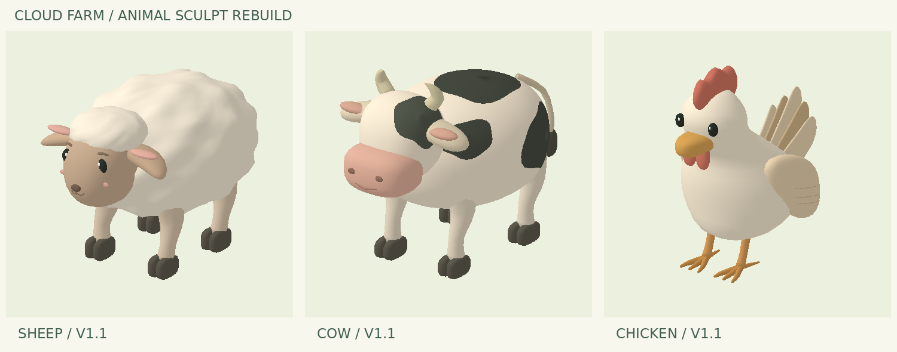
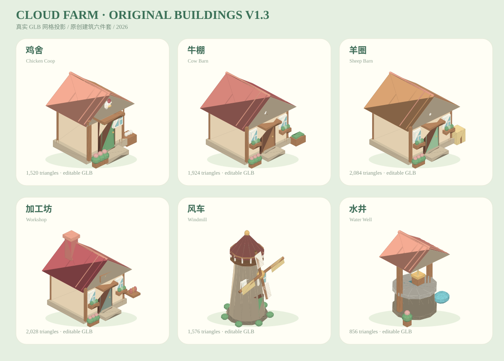

# 云朵农场 · 原创三维美术 V1.3 原创建筑精修测试版

当前分支为 `art-v1-test`，版本 `v0.24.0-buildings-test`。main / GitHub Pages 正式版保持 v0.18.0，未合并或覆盖。

- [模型互动预览](preview.html)
- [游戏测试入口](index.html)
- [资源说明、编辑方法与验收清单](docs/ART_V1.md)
- [验证记录](docs/validation.json)
- [八个主模型、三个 LOD 的 GLB / GLTF 与生成源码](assets/art-v1/)

本地用任意静态 HTTP 服务打开项目；不要直接双击 HTML，因为浏览器可能阻止模型 fetch。

```bash
python3 tools/build_art.py
node tests/art-v1.test.cjs
python3 tools/render_art.py
```

生成工具需要 Python 3、numpy、Pillow；游戏、模型预览和 Node 测试没有 npm 依赖。当前自动验证使用 Node VM 测试替身；真实手机浏览器、触摸手势和帧率待验收，详见说明。



## 🖥️ 电脑版直接测试（v0.24.1）

- [电脑打开完整农场游戏](https://raw.githack.com/Gky666-cell/cloud-farm-3d/art-v1-test/index.html)
- [旋转预览全部原创 3D 模型](https://raw.githack.com/Gky666-cell/cloud-farm-3d/art-v1-test/preview.html)
- [电脑操作、验收步骤和故障排查](docs/PC_TEST.md)

支持鼠标拖动、滚轮缩放、WASD / 方向键平移、R 复位、M 菜单、B 仓库、Esc 返回。公开预览通过第三方 CDN 提供，首次可能需要确认；此分支测试存档仍与正式版隔离。GitHub Actions 自动验证不代表已经进行真实浏览器人工验收。

## V1.2 更新（待手机验收）
- 主屋降低屋檐并补充墙体连接件，解决屋顶与房屋脱节感。
- 奶牛及低面数奶牛增加眼白、前移眼睛/高光，增加深入躯干的尾根连接网格。
- 同步保存修正版 GLB/GLTF、源代码、资源清单及导入缓存版本。
- 正式 main 仍是 v0.18.0；此分支手机帧率与触摸体验待实机验证。原 V1.1 ZIP 为旧档案，最新 GLB/GLTF 请从 assets/art-v1 获取。

## V1.3 建筑包与场景改进
已新增六个原创 GLB/GLTF：鸡舍、牛棚、羊圈、加工坊、风车、水井；同步到主岛与独立牧场（或鸡舍）场景。源文件在 `tools/build_buildings.cjs`，细节参见 [原创建筑 V1.3 说明](docs/BUILDINGS_V1_3.md)。原 V1.1 ZIP 为历史归档。正式分支不更改。

### 六座原创建筑实物模型总览

