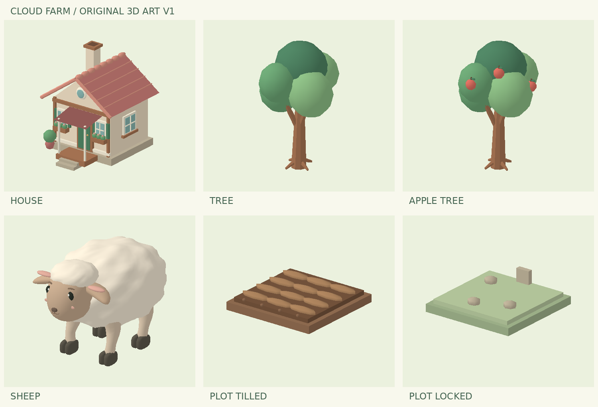
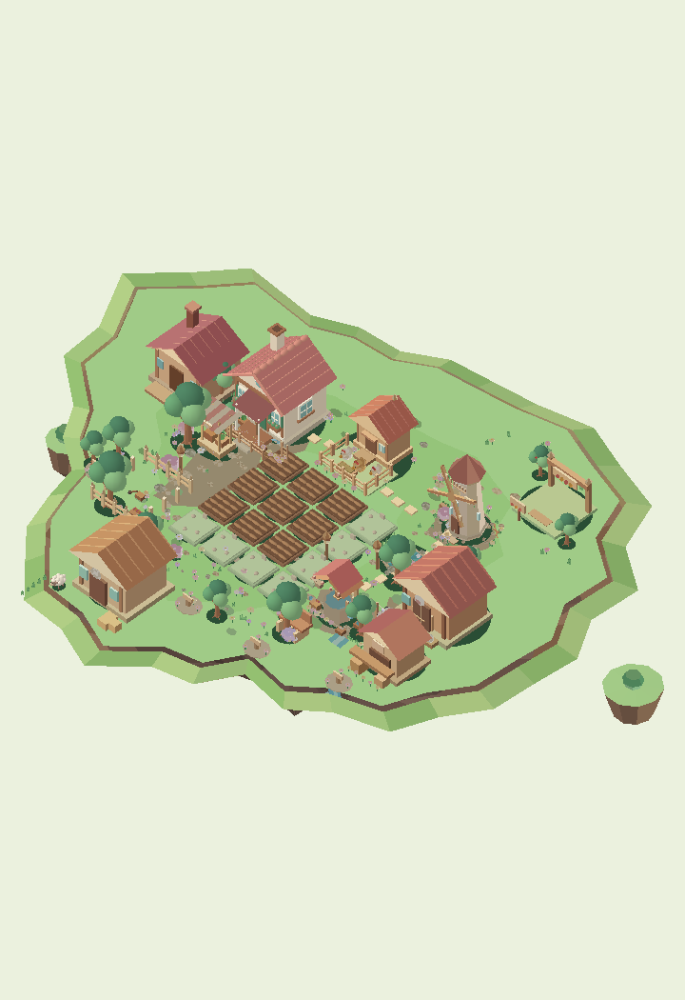

# 原创 3D 美术资源包 V1.2

风格：奶油色建筑、鼠尾草绿门窗、珊瑚陶瓦、柔和圆润树冠、奶油绵羊。所有网格由本仓库源码生成，没有下载第三方模型或用概念图片冒充模型。

## 动物造型修订

上一版羊毛为球体堆叠、腿为直杆，牛和鸡未换新模型。本版羊毛改为单张连续起伏曲面，腿采用变截面弯曲网格，蹄子有分趾；奶牛增加肩腹、口鼻、耳角与贴合表面的花斑；鸡的身体与颈部连为一体，增加成形翅膀、尾羽、脚趾及鸡冠。模型没有毛发粒子，保持手机可用的网格预算。

近景（放大到 2× 以上）使用高细节模型，远景自动使用 LOD。羊/牛/鸡近景面数分别约 9,824 / 11,686 / 7,156；远景分别约 3,520 / 3,944 / 3,006。跨过缩放阈值会重建静态和动态合批缓冲，仍保持两次绘制。测试验证了切换和生产逻辑；实机 FPS 待验收。

## 文件与编辑

`assets/art-v1/` 包含 8 个主模型与 3 个动物 LOD，共 11 个 GLB 和相应的自包含 GLTF。新增 `cow`、`chicken`，并重做 `sheep`；低细节版本为 `sheep-lod`、`cow-lod`、`chicken-lod`。均为 glTF 2.0，Y 向上、+Z 朝前，使用游戏世界单位。模型底部位于原点附近；普通树根最低点约 -0.004，在游戏中放置于地面之上。材质为标准 PBR 纯色材质；牛的花斑使用贴合身体曲面的薄网格，边界连续平滑，不依赖外部纹理。

Blender：文件 → 导入 → glTF 2.0 → 选择 GLB；在 Outliner 展开模型根节点，可单独修改屋顶、门窗、树冠、羊腿等命名网格。编辑网格、材质颜色和对象变换后可重新导出 GLB。保留地面原点、朝向、尺寸和 `fruit-` 名称前缀；苹果成熟控制依靠该前缀隐藏全部水果部件。默认 GLB 即可编辑，无需运行生成工具。

参数源码在 `tools/build_art.py`，修改调色板 `P`、几何坐标、尺寸或部件后运行 `python3 tools/build_art.py`。仅需要 Python 3 和 numpy。V1 为静态网格，没有骨骼、蒙皮或作者动画；现有游戏的移动、轻微起伏仍正常执行。

轻量导入器 `loader.js` 支持标准静态三角网格、索引、位置、法线、纯色材质、float COLOR_0 顶点色和节点 TRS/矩阵变换，随后合并为现有 WebGL 顶点流。它不是完整 glTF 引擎：暂不支持纹理、蒙皮、Draco、稀疏或归一化 accessor。重新导出请保持纯色静态模型、不添加压缩扩展。导入失败时恢复 v0.21.0 原模型，游戏经营功能继续工作。GLB/GLTF 可在其他完整 glTF 软件中独立使用。

## 游戏接入

- 独立分支 `art-v1-test`，版本 `v0.23.1-art-fixes-test`；基于 v0.21.0 美术底稿，正式 main 与 GitHub Pages 不改动。
- `index.html` 为完整经营测试版；`preview.html` 为资源预览，可单指旋转、双指缩放、选择部件改颜色，下载原始文件。
- 主屋、场景普通树、羊圈与放养绵羊、奶牛、小鸡、16 块农田底座使用实际 GLB。苹果树接入果园的生长、成熟、采摘和再结果阶段；橘子树及其他设施继续使用旧版模型。
- 经营流程、固定角度竖屏投影、拖动、捏合缩放和触摸命中算法保留。
- 测试存档键为 `yun-farm-3d-art-v1-test`。同一站点若存在正式存档，首次只读取并复制；所有后续保存仅写测试键。独立测试站点与 GitHub Pages 属于不同来源，因此不会自动读取 GitHub Pages 的存档，也不会影响它。

## 验证和性能

运行 `node tests/art-v1.test.cjs`，然后 `python3 tools/render_art.py` 生成基于实际导入网格的 CPU 渲染预览。基线 HTML 保留在 `tests/baseline-v018.html` 和 `tests/baseline-v021.html`。所有检查结果在 `validation.json`。

已检查：GLB/GLTF 一致性、有限坐标与单位法线、十一个模型加载、果实分组隐藏、存档隔离和重载、种植收获、鸡蛋、牛奶和羊毛生产、苹果生长采摘、加工和订单、七个场景网格、竖屏投影命中、触摸处理器注册、资源失败回退。还修复旧版 `fence()` 对过窄边长使用 0 分段导致除以零的问题。

资源下载约 1147 KiB（11 个 GLB）；远景主岛静态面数约 83,123（v0.21.0 为 114,979，v0.18.0 为 72,766）。静态和动态分别合批，仍为 2 次 draw call。去除旧球体每个极点的退化三角面，保留有效表面。DPR 上限 1.5，目标渲染约 30 FPS，后台页面跳过绘制。这些是网格预算与代码设置，不是测得的手机 FPS。

**验证边界：当前环境没有可用的浏览器控制能力。测试在 Node VM 中执行真实游戏逻辑与导入器，DOM/WebGL 调用由测试替身提供。预览 PNG 是实际模型和场景顶点流的离线渲染，不是浏览器截图。浏览器 WebGL shader、实际触摸操作、GLB 在 Blender 中的人工编辑与手机 FPS 尚未实测。**

## 手机验收顺序

1. 打开预览页，旋转全部模型，检查背面和细节；任选部件改颜色。
2. 进入测试农场，确认主屋、普通树与农田摆放合适，拖动和捏合时无异常。
3. 连种、收获；进羊圈喂羊，50 秒后剪毛；测试放养和驱赶。
4. 果园购买苹果树，成熟后采摘，再次结果；测试加工、订单与重开存档。
5. 在手机持续操作 3–5 分钟，检查卡顿、发热与后台返回。按需要降低 DPR/帧率；验收通过后另行决定合并与上线，当前不合并。

## V1.2 屋顶 / 奶牛几何修复

- `house.glb`：两侧屋面檐口 Y 从 1.94 调整至 1.68，屋顶坡面与墙体交接；补充两处独立 `roof-to-wall-connection-*` 网格。
- `cow.glb` 与 `cow-lod.glb`：新增双侧 `eye-ivory-sclera-*` 眼白，瞳孔和高光前移；新增 `tail-root-connected` 锥形连接网格，尾根嵌入牛体并接到尾巴曲面。
- 三个修正模型均已重新构造为 GLB 2.0 和自包含 GLTF，并同步修改 `tools/build_art.py`、`tools/animal_shapes.py` 生成源码；加载 URL 已更新缓存版本。
- 本轮进行了模型几何及格式结构检查，但未完成真实手机 WebGL、FPS、点击/手势回归验证；详见 `docs/validation.json`。
- `downloads/cloud-farm-original-art-v1-1.zip` 是旧版本归档；最新三个修复模型请从 `assets/art-v1/` 获取。
